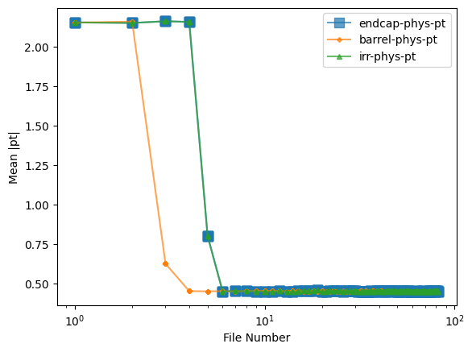

# Welcome to our SmartPixels ML project
## Usage
### Setup environment (w/ optional GPU support)
```
source setup.sh
```
Look at the notebook `playground.ipynb` for data exploration.

### Optional: Generate dataset configs
```
python generate_ds_configs.py --data-root /path/to/datasets --output-dir config --test-ratio 0.2
```
This derives data splits feature scaling params (linear mapping to `mean=0` and `std=1` after symlog transform on `X`.)

### Train a model
```
python train.py -c config/v3.yml -a conv2d --task regression
```
### Evaluate a model
```
python evaluate.py --input /path/to/model.pt -c config/v3.yml
```

## The data
There are two datasets on zenodo: https://zenodo.org/records/10783560 (3 versions) and https://zenodo.org/records/17180303 (1 version).
The latest versions of both contain charge deposits shape `(t, y, x) = (20, 13, 21)` (or permutations thereof). Meaning short videos with 20 frames of 13x21 (x,y) each. There are 13 labels (w/ example values):
```
x-entry              129.128448
y-entry              -13.157045
z-entry              100.000000
n_x                   -1.716407
n_y                    0.092777
n_z                   -0.630184
number_eh_pairs    15612.000000
y-local                2.733230
pt                    -0.637653
cotAlpha               2.723660
cotBeta               -0.147222
y-midplane            -5.795941
x-midplane            -7.054556
```
### Remarks
For the dataset `17180303`, the first few files of each dataset seem to have a different pT distribution than the rest. In particular, the first 3 files of each barrel-phys-pt dataset and the first 5 files of each endcap-phys-pt and irradiated-phys-pt dataset are off:

## Existing Papers & Code
"Smartpixels: Towards on-sensor ..." (https://arxiv.org/pdf/2312.11676) uses mixture density network to regress 4 variables (x, y, alpha, beta) and their covariance matrix. They use a 2D depth-seperable conv that treats the 20 time slices as independent channels. In their code, they seem to also experiment with using only a subset of time slices, e.g. first and last (`use_time_stamps = [0, 19]`).

"Sensor Co-design for smartpixels" (https://arxiv.org/pdf/2510.06588v1) analyzes the y-profile of the data. reduces the data to 14-dim arrays (y0 and 13 y-pixels). I believe it only considers the last frame and sums over x (`x[19, :, :].mean(axis=2)`). But I cannot yet find this in the code.

In their code, they als reference a `16x16` model. But I dont know what data that takes. In general, I believe the codebase here https://github.com/smart-pix/smart-pixels-ml/ is only used for the `towards` paper, as important keywords (such as `128` for number of neurons according to the other paper) dont appear anywhere.

## Open Questions
- Where is the source code for the `Co-design` paper?
- Why the different `pT` spectrum for the first files? (Not so important as not used for training)
- Usage of `y0` in input `y`-profile: this is a *label*, right? Is it legit to use this in the input? Would it be available in real-world deployment?
- Paper says 800,000 clusters. We have 8,000,000 events.
- Why train a 3-class classifier and then evaluate as binary classifier?
- About the 200 MeV vs 2 GeV thing: why not train a regressor and cut on the prediction? Why not control precision / recall via weight?
- Are you discarding some high-pT events to achieve a balanced dataset? If so, why not used weighted samples instead for higher data variance?
